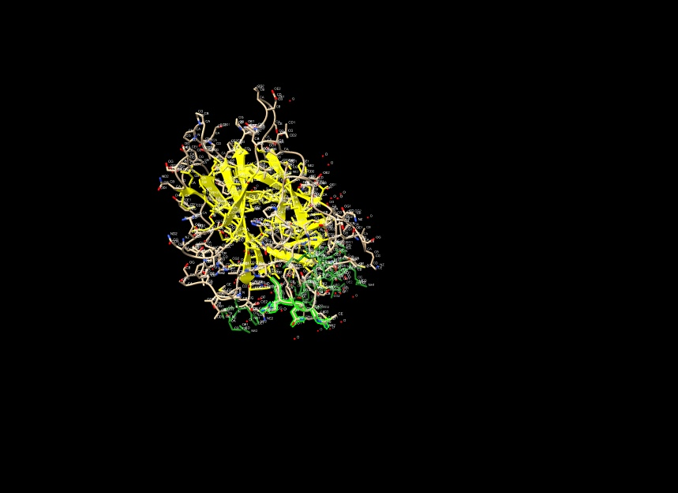
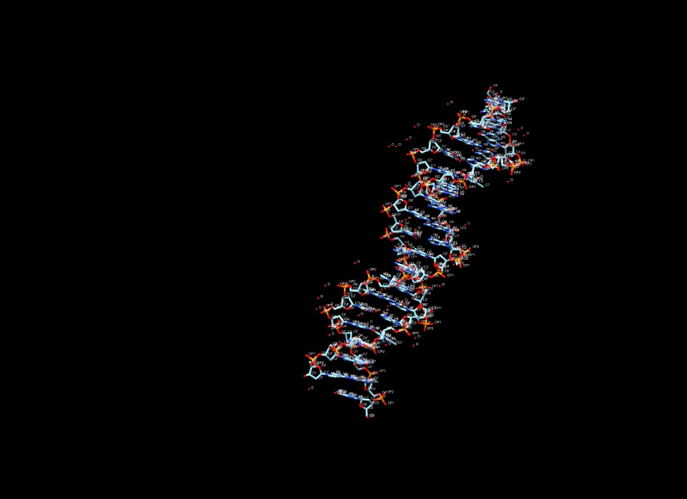
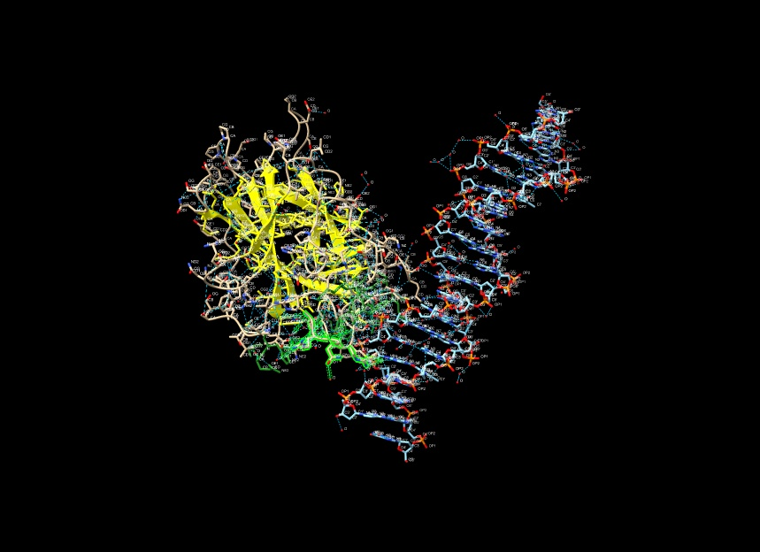

# Scientist’s Mission (0153B049, 鍾佩琪)
## Who Stole TP53’s Superpower? Searching for the Key to Unlock Cancer
### Using AI to Uncover the Secrets of TP53–DNA Interactions

---

### 1. 【The LEGO Assembly Line】
**What type of bond links amino acids together to form a protein? Which amino acids form hydrogen bonds with each other?**

**Answer:**

#### 1. The Bond That Links Amino Acids
Amino acids are linked together by peptide bonds (amide bonds). These covalent bonds are formed via a dehydration synthesis reaction between the carboxyl group ($-\text{COOH}$) of one amino acid and the amino group ($-\text{NH}_2$) of the next, releasing a water molecule.

#### 2. Hydrogen Bonds in TP53 (PDB 3KMD)
In the crystal structure of the p53 core domain bound to DNA (PDB 3KMD), hydrogen bonding plays a critical role in stabilizing both the internal 3D fold of the protein and its sequence-specific recognition of DNA.

Hydrogen bonds in this structure occur across three main contexts:
* **Backbone-to-Backbone Hydrogen Bonds:** Formed between carbonyl oxygens ($\text{C=O}$) and amide hydrogens ($\text{N-H}$) along the polypeptide backbone. These stabilize the regular secondary structures of p53, notably the central $\beta$-sandwich scaffold that provides the structural framework for the core domain.
* **Side-Chain Polar Networks (Internal Stabilization):** Polar and hydrophilic amino acid side chains form intricate hydrogen-bonding networks internally to maintain the tertiary conformation. Key residues involved include Serine (Ser), Threonine (Thr), Asparagine (Asn), Glutamine (Gln), Tyrosine (Tyr), and Threonine, which donate or accept hydrogen bonds to keep loops and sheets tightly packed.
* **Side-Chain-to-DNA Hydrogen Bonds (Functional Interaction):** In 3KMD, p53 forms specific hydrogen bonds with the DNA base pairs and phosphate backbone to recognize its consensus sequence. Key residues like Arginine (Arg) (e.g., Arg248, Arg273) and Lysine (Lys) form vital hydrogen bonds and electrostatic interactions with the DNA backbone and bases, while Asparagine (Asn) and Glutamine (Gln) often reach into the major groove to form direct hydrogen bonds with specific DNA bases.

---

### 2. 【The Double-Track Highway of Life’s Blueprint】
**How do nucleotides assemble to form double-stranded DNA? What are the basic structural components of DNA? Is DNA right-handed or left-handed? List the names of the four DNA bases. Which bases form hydrogen bonds with each other?**

**Answer:**

#### 1. Basic Structural Components of DNA
Each nucleotide in DNA consists of three core components:
* A 5-carbon sugar (deoxyribose)
* A phosphate group
* A nitrogenous base (Adenine, Thymine, Cytosine, or Guanine)

#### 2. How Nucleotides Assemble to Form Double-Stranded DNA
* **Single Strands (Backbone):** Nucleotides link together via covalent phosphodiester bonds connecting the 3' carbon of one sugar to the 5' carbon of the next, forming a strong sugar-phosphate backbone.
* **Double Strands (Helix):** Two single strands run in opposite directions (antiparallel) and twist into a double helix. They are held together in the center by hydrogen bonds between complementary bases.

#### 3. Handedness of DNA
Standard cellular DNA (B-DNA) is right-handed, meaning the helix twists clockwise as it moves away from you.

#### 4. The Four DNA Bases
* Adenine (A)
* Thymine (T)
* Cytosine (C)
* Guanine (G)

#### 5. Base Pairing and Hydrogen Bonds
The bases pair up specifically via hydrogen bonds to form the rungs of the DNA ladder:
* Adenine (A) always pairs with Thymine (T) via 2 hydrogen bonds.
* Cytosine (C) always pairs with Guanine (G) via 3 hydrogen bonds.

---

### 3. 【Searching for My One-and-Only Soulmate in the Universe: A 20-Base-Pair Love Code Hidden Among 3 Billion DNA Base Pairs】
**The source of molecular stability and specificity: hydrogen bonding — How do TP53 and DNA recognize each other?**  
**Using the structure 3KMD, identify one pair of an amino acid and a DNA base that interact with each other.**

**Answer:**

Based on the crystal structure of the human p53 core domain bound to its consensus DNA site (PDB ID: 3KMD), a prominent and well-characterized pair of interacting residues is:
* **Amino Acid:** Lysine 120 (Lys120) located in the L1 loop of the p53 protein.
* **DNA Base:** Guanine (G) within the consensus sequence.

#### Structural Details of the Interaction
* **Location and Groove:** Lys120 extends directly into the major groove of the DNA target site.
* **Hydrogen Bonding:** The side chain of Lys120 forms a pair of stable hydrogen bonds with the N7 atom of the guanine base.
* **Role in Specificity:** This direct hydrogen-bonding interaction is critical for the sequence-specific "readout" of the p53 response element, allowing the tumor suppressor to precisely target and bind its specific genomic sites to regulate transcription.

---

### 4. 【Return to the Crime Scene】
**Why can a mutation (change) in just one amino acid of a protein sometimes lead to a serious human disease? Give one specific example of such a disease.**

**Answer:**

---

### 5. 【Return to the Crime Scene: Searching for Clues】
**Using the TP53–DNA structure (3KMD), identify one TP53 amino acid mutation that can lead to uncontrolled cell division and contribute to the development of cancer.**  
**Then examine this amino acid in ChimeraX. Based on its three-dimensional position, determine whether the mutated amino acid is located directly at the protein–DNA interface or somewhere else in the protein.**

**Answer:**

a. **Visualization:**

b. Save your ChimeraX session file as `StudentID.cxs`.